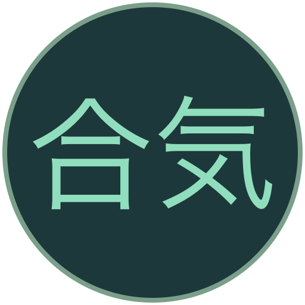

<p align="center"></p>

# Aikidō Circle Training · Keiko 稽古

**Deutsch** | [English](README.en.md)

[](https://github.com/ottlinger/aikido-circle-training/actions/workflows/tests.yml)

Eine lokale JavaScript-Anwendung zur Visualisierung des Aikidō-Trainingskreises. Geübt wird **immer zwischen zwei Partnern** (Nage und Uke); der Kreis organisiert das Training aller mit allen. Keine personenbezogenen Daten, kein Backend, keine externen Bibliotheken oder Netzwerkanfragen. Im Footer führt ein GitHub-Link mit Octocat-Logo zum [Quellcode](https://github.com/ottlinger/aikido-circle-training).

## Starten

`index.html` direkt im Browser öffnen. Kein Build und keine Installation erforderlich.

Alternativ über einen lokalen Webserver:

```sh
python3 -m http.server 8888
```

Dann <http://localhost:8888> öffnen. Mit der vorhandenen Docker-Konfiguration geht auch `docker compose up -d` (gleiche Adresse).

## Bedienung

- **Sprache:** Oben rechts zwischen **Deutsch** und **English** wählen. **Deutsch ist bei jedem Laden der Standard**, unabhängig von der Browsersprache. Der Wechsel übersetzt die gesamte Oberfläche einschließlich Kreis, Status, Zählern, Erklärungen und Screenreader-Texten, ohne das Training zu pausieren oder zurückzusetzen. Die Sprachwahl wird nicht gespeichert.
- Beim Laden wird eine zufällige Gruppengröße von **3 bis 20** gewählt. Über den Regler oder „Zufällige Gruppe“ lässt sie sich ändern.
- Richtung, **2 oder 4 Wiederholungen pro Partner**, Startpartner und **Rolle im Kreisinneren** wählen: **Nage wandert und wirft** (Standard) oder **Uke wandert und greift an**.
- **Runden pro Teilnehmer:** **1, 2, 3 (Standard), 5 oder 10 Runden** oder **Unendlich** wählen. Jeder Teilnehmer besucht pro Runde alle anderen. Das Training stoppt automatisch, sobald alle ihre gewählten Runden beendet haben; niemand beginnt eine zusätzliche Runde. „Unendlich“ behält den bisherigen fortlaufenden Ablauf bei.
- Starten, pausieren, einzelne Würfe schrittweise ausführen oder zurücksetzen. Nach Trainingsende beginnt **„Neu starten“** ein neues Training mit denselben Einstellungen.
- Sprache und Tempo lassen sich auch während des Trainings ändern. Andere Einstellungen setzen das Training zurück.
- Jedes aktive Zweierpaar hat eine eigene gemeinsame Farbe. Die innere Figur ist ausgefüllt, der feste Kreispartner hat einen farbigen Rand. **N** kennzeichnet Nage, **U** Uke; die Position der Rollen hängt vom Modus ab. Blau bedeutet Rückkehr/Warten; gestrichelte Kreise markieren freie Startplätze.
- An jeder inneren Figur steht **ausgeführt / insgesamt**, z. B. `8/14`. Listen und Startpartnerübersicht zeigen zusätzlich die **noch verbleibenden Würfe** (Nage-Modus) bzw. **Angriffe** (Uke-Modus). Pfeile führen vom inneren Teilnehmer zum festen Kreispartner: als Wurf- bzw. Angriffsrichtung.
- Eine eigene Runde umfasst `(Teilnehmerzahl − 1) × Wiederholungen`. Im Uke-Modus ist eine Wiederholung ein Angriff mit anschließendem Wurf durch den festen Nage; der Angriff zählt nicht zusätzlich als zweiter Schritt. Die globale Wurfzahl zählt in beiden Modi die tatsächlich simulierten Würfe. Übungen mit später vorbeikommenden Nachfolgern verändern den bereits abgeschlossenen eigenen Rundenzähler nicht.
- „Aktuelle Runde aller Teilnehmer“ beginnt bei **1 / 3** (Standard) bzw. **1 / ∞**. Die Anzeige wechselt zur nächsten Runde, sobald alle die vorherige abgeschlossen haben. Am Trainingsende bleibt sie bei der gewählten Rundenzahl, z. B. **3 / 3**. In der Kreismitte steht **Keiko**, im Logo **合気 (Aiki)** und im Footer **稽古 (Keiko)**.

## Simulationsmodell

Die nummerierten Startplätze bleiben fest. Im Standardmodus bewegt sich **Nage** innen zum jeweiligen festen **Uke** und wirft ihn. Im zweiten Modus bewegt sich **Uke** innen zum jeweiligen festen **Nage**, greift ihn an und wird von ihm geworfen. Nach 2 oder 4 Wiederholungen folgt der Partnerwechsel. Der innere Teilnehmer kehrt erst nach allen Partnerübungen sichtbar an seinen Startplatz zurück. Wartet er auf den nächsten Partner, bleibt er innen beim zuletzt besuchten Kreisplatz – hinter seinem Vorgänger. Die Plätze sind Orientierungshilfen, keine zusätzlichen Personen; jeder Teilnehmer hat genau eine Figur. Die Bewegung ist schematisch, keine physikalische Simulation.

1. Der Startpartner übt mit dem nächsten Nachbarn in der gewählten Richtung.
2. Nach 2 oder 4 Wiederholungen wechselt er zum nächsten Partner. Sein erster Partner folgt nun mit Abstand und derselben inneren Rolle. Jeder weitere Teilnehmer beginnt erst nach der Übung mit seinem **direkten Vorgänger**: Partner 3 nach Partner 2, nicht bereits nach Partner 1.
3. Jeder besucht alle anderen genau einmal pro eigener Runde, in der gewählten Kreisrichtung. Der erste Nachfolger endet beim ursprünglichen Startpartner.
4. Nach der eigenen Runde kehrt der Teilnehmer an seinen Startplatz zurück und wartet, bis jeder andere ihn für diese Runde besucht hat. Dort ist er Uke (Nage wandert) oder Nage (Uke wandert).

**Die Welle hat eine feste Reihenfolge:** Es können mehrere unabhängige Zweierpaare gleichzeitig trainieren, aber niemand überholt seinen Vorgänger. Ein innerer Teilnehmer wechselt **niemals zwischendurch zum festen Kreispartner** oder in die andere Rolle. Er beendet zuerst seine ganze Runde. Auch an jedem Kreisplatz kommen die inneren Teilnehmer in der festen Reihenfolge des Startpartners und seiner Nachfolger vorbei (die eigene Person wird übersprungen). Ein belegtes Ziel oder ein noch nicht vorbeigegangener Vorgänger führt zu einer Pause.

Beispiel: 5 Teilnehmer, Startpartner 1, Uhrzeigersinn, 2 Würfe pro Partner. Partner 1 wirft **2 → 3 → 4 → 5**, insgesamt **8 Würfe**, und kehrt dann zurück. Partner 2 folgt mit **3 → 4 → 5 → 1**. Somit ist Partner 2 der erste, der den zurückgekehrten Partner 1 wirft. Danach folgen Partner 3, 4 und 5. Partner 3 startet erst nach der Übung **2 → 3**.

Im Uke-Modus besucht Partner 1 ebenfalls **2 → 3 → 4 → 5**, greift jeden zweimal an und empfängt insgesamt **8 Würfe**. Partner 2 folgt als Uke mit **3 → 4 → 5 → 1**. Nachdem Partner 1 zurückgekehrt ist, greift ihn also zuerst Partner 2 an; Partner 1 wirft ihn am festen Kreisplatz.

Für die nächste Runde müssen alle anderen einen für die vorherige Runde besucht haben. Der Startpartner eröffnet die neue Welle; die Nachfolger steigen erneut ein, wenn ihr direkter Vorgänger mit ihnen geübt hat. So bleibt auch über mehrere Zyklen hinweg der Abstand erhalten. Eingehende abgeschlossene Partnerübungen werden pro vorbeikommendem Teilnehmer gezählt. Ein Simulationsschritt ist ein Wurf **je aktuellem Paar**; nach der letzten Wiederholung werden die nächsten konfliktfreien Paare gebildet. Die Rückkehr wird mindestens einen Zustand lang gezeigt. Falls gerade alle zurückkehren, ist der nächste Schritt ein Partnerwechsel ohne Wurf.

## Projektlogo auf GitHub

- `assets/logo.svg`: skalierbares Aiki-Kreislogo. Die Kanji **合気** sind Vektorpfade; es werden keine japanischen Schriftarten benötigt. Anwendung und Favicon verwenden dieselbe Datei.
- `assets/logo.png`: 512 × 512 Pixel mit transparenten Ecken; als Projektlogo oben in beiden READMEs eingebunden.
- `assets/favicon.png`: 32 × 32 Pixel; `assets/favicon.ico`: 16, 32 und 48 Pixel. Beide sind neben dem SVG-Favicon als Fallbacks in `index.html` verlinkt.
- `assets/social-preview.png`: 1280 × 640 Pixel, vorbereitet für GitHubs Social Preview (unter 1 MB).

GitHub hat kein separates Repository-Avatar-Feld. Für das Vorschaubild den Repository-Bereich **Settings → General → Social preview → Edit → Upload an image** öffnen und `assets/social-preview.png` hochladen. Der Upload lässt sich nicht über die reguläre GitHub-API oder `gh repo edit` setzen.

## Dateien und Tests

- `index.html`: Oberfläche und SVG-Trainingskreis
- `styles.css`: responsive Darstellung, Farben und Animationen; berücksichtigt reduzierte Bewegung
- `simulation.js`: rollenunabhängige Partnerwechsel (`mover`/`partner`) und Nage/Uke-Zuordnung je Modus, auch mit Node.js testbar
- `visualization.js`: Layout für feste Kreisplätze, bewegte Nage oder Uke und Paarfarben
- `i18n.js`: lokale deutsche und englische Übersetzungen, Platzhalter und Zahlenformatierung
- `app.js`: Browsersteuerung, Sprachwechsel und SVG-Animation
- `tests/simulation.test.cjs`, `tests/visualization.test.cjs`, `tests/i18n.test.cjs`, `tests/app.test.cjs`: Tests ohne zusätzliche Abhängigkeiten

Mit Node.js (18 oder neuer) und npm:

```sh
npm test
```

Weder `npm install` noch ein Build-Schritt ist nötig: Die Tests verwenden ausschließlich integrierte Node.js-Module. Die `package.json` ist als privat markiert und enthält Entwicklungsmetadaten sowie den Testbefehl; die App lässt sich weiterhin durch direktes Öffnen der `index.html` starten.

Die GitHub Action `.github/workflows/tests.yml` prüft bei jedem Push und Pull Request die JavaScript-Syntax und führt sämtliche Tests auf **Node.js 18, 22 und 24** aus. Sie kann auch manuell gestartet werden. Das Badge oben zeigt den tatsächlichen Status der Tests auf `main` – grün nach einem erfolgreichen Lauf.

Die Tests prüfen **beide Modi**, alle Gruppengrößen, beide Richtungen und beide Wiederholungszahlen über mehrere Runden: keine Doppelbelegung, kein Überholen, keine Rollenwechsel während einer inneren Runde, korrekte Reihenfolge, Einstieg nur durch den direkten Vorgänger, Wartebedingung, sichtbare Rückkehr und kein Stillstand. Der bestätigte Ablauf „Partner 1 wirft alle, kommt zurück und wird zuerst von Partner 2 geworfen“ und die Variante mit angreifendem Uke sind ausdrücklich getestet. Zählertests prüfen jede ausgeführte/verbleibende Wiederholung. Begrenzte Trainings werden für alle angebotenen Rundenzahlen geprüft: exakter Abschluss aller Teilnehmer ohne zusätzliche Runden und keine Änderungen nach Trainingsende. Steuerungstests prüfen Standardauswahl, Einzelschritte, automatisches Stoppen, Neustart, Sprachwechsel nach Abschluss und den unendlichen Betrieb. Layouttests prüfen die feste und die innere Position, korrekte Nage/Uke-Zuordnung, eindeutige Paarfarben und genau eine Figur pro Person. Übersetzungstests prüfen Deutsch als Standard, vollständige Sprachkataloge, identische Platzhalter, statische und dynamische Texte, Screenreader-Beschriftungen und sprachabhängige Zahlenformate.
